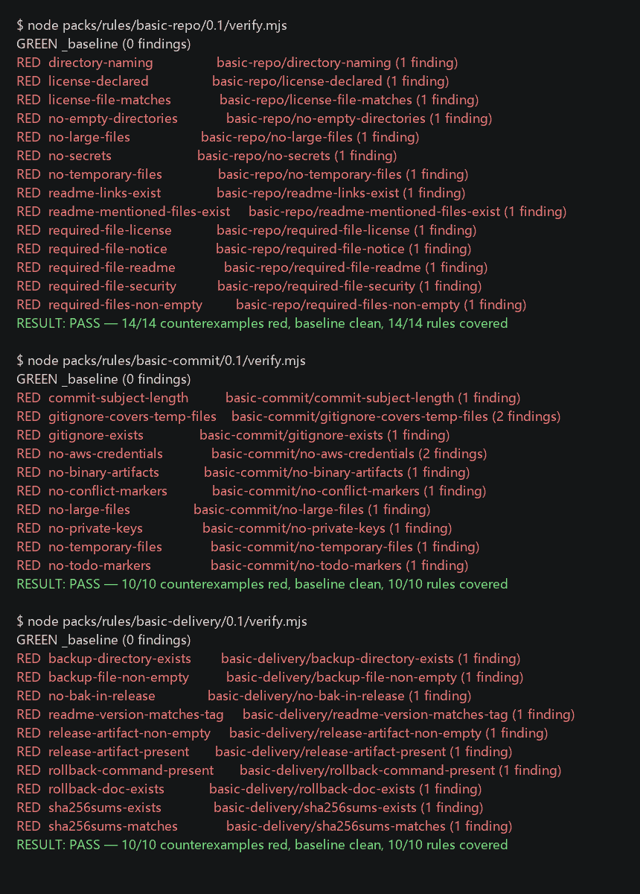
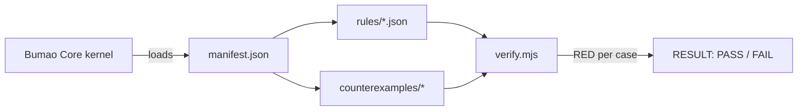

# Bumao Packs

[](LICENSE)


[](https://hub.xerj.org/contributors/Bumao-Ai)

**English**

Optional rule packs for Bumao Core — install what you need, keep the kernel minimal.

1. **What this is:** a catalog of rule packs you drop into Bumao Core; the kernel itself is not here.
2. **Who it is for:** people who want checks available as soon as a repository is set up.
3. **What it solves:** the kernel only judges; rules come from packs — installing nothing breaks nothing, installing gives you content.

> Every pack ships counterexamples. Run them yourself and watch them go red — that is how you know a pack is not decoration.



*Real `node verify.mjs` output for the three packs: 34/34 counterexamples red, baseline clean. Terminal capture, no mock UI.*

## Quick start

```bash
git clone https://github.com/Bumao-Ai/Bumao-packs.git
cd Bumao-packs
node packs/rules/basic-commit/0.1/verify.mjs
```

Expected last line:

```
RESULT: PASS — 10/10 counterexamples red, baseline clean, 10/10 rules covered
```

No Node package install is needed: `verify.mjs` uses Node built-ins only (Node 18+).

## Proof of work

| Item | Value | Source |
|---|---|---|
| Commits | 11 (at tag `v0.1.2`) | `git rev-list --count v0.1.2` |
| Last commit | 2026-11-09 | `git log -1 --date=short` |
| Packs | 3 | `index.json` |
| Rules | 34 (14 / 10 / 10) | `packs/rules/*/0.1/rules/*.json` |
| Counterexamples | 34 (14 / 10 / 10) | `packs/rules/*/0.1/counterexamples/*/` |
| Self-check | 3/3 `RESULT: PASS` | `node packs/rules/<pack>/0.1/verify.mjs` |
| Releases | 5 tags, latest `v0.1.2` (2026-11-09) | `git tag --list` |
| Changelog | [CHANGELOG.md](CHANGELOG.md) | — |

**Repository release:** `v0.1.2` (2026-11-09). Pack contents stay at `0.1`; the repo-wide tag version tracks documentation and catalog changes. The pack archives attached to `v0.1.2` are byte-identical to `v0.1.1` (same SHA-256).

## Roadmap (0.2 — in progress)

- **Before execution** — declare intent before acting; the kernel judges the declaration. *(in progress)*
- **During execution** — continuous checks while the agent runs. *(in progress)*
- **After execution** — audit trail linking action, basis, result and exception. *(in progress)*

## Architecture



## Packs

| Pack | Version | Kind | Rules | Counterexamples | Requires contract | Archive |
|---|---|---|---|---|---|---|
| `basic-repo` | `0.1` | rules | 14 | 14 | `bumao.rule-pack/v1` | [basic-repo-0.1.zip](https://github.com/Bumao-Ai/Bumao-packs/releases/download/v0.1.2/basic-repo-0.1.zip) |
| `basic-commit` | `0.1` | rules | 10 | 10 | `bumao.rule-pack/v1` | [basic-commit-0.1.zip](https://github.com/Bumao-Ai/Bumao-packs/releases/download/v0.1.2/basic-commit-0.1.zip) |
| `basic-delivery` | `0.1` | rules | 10 | 10 | `bumao.rule-pack/v1` | [basic-delivery-0.1.zip](https://github.com/Bumao-Ai/Bumao-packs/releases/download/v0.1.2/basic-delivery-0.1.zip) |

`index.json` is the machine-readable catalog: pack id, version, contract, download URL, SHA-256 and size.

## What gets checked

- `basic-repo` — required files, directory naming, empty directories, license consistency, README references, temporary files, large files, secret-looking strings.
- `basic-commit` — missing `.gitignore`, files over 1 MiB, private keys and AK/SK shapes, binary artifacts, `.tmp` / `.bak` / `~` residue, TODO / FIXME markers, empty or too-short commit subjects, conflict markers.
- `basic-delivery` — non-empty backup, `SHA256SUMS` matching real files, README version matching the tag, documented rollback command, a `.zip` release artifact, no `.bak` in `release/`.

All rules are machine-checkable. A pack is listed in `index.json` only after every counterexample goes red.

## Install into Bumao Core

No `bumao-pack install` command is provided yet. Three steps, the same for every pack:

1. Copy the pack directory into `<bumao-core>/packs/rules/<pack>/0.1/` (**replace `<bumao-core>` with your own kernel path**).
2. Point your Bumao Core pack configuration at that directory — the one containing `manifest.json` and `rules/`.
3. Run `node verify.mjs` inside it; every counterexample must print `RED`, then run one `check` against a real repository. `basic-delivery` additionally needs `--tag v0.1`.

## Verify a download

```bash
sha256sum -c SHA256SUMS
```

Windows PowerShell:

```powershell
(Get-FileHash .\basic-repo-0.1.zip -Algorithm SHA256).Hash.ToLower() -eq (Get-Content .\SHA256SUMS).Split()[0]
```

The expected digest and size are also recorded in `index.json`.

## Layout

```text
bumao-packs/
├── index.json                 # machine-readable catalog
├── packs/rules/
│   ├── basic-repo/0.1/        # manifest.json, rules/, counterexamples/, verify.mjs
│   ├── basic-commit/0.1/
│   └── basic-delivery/0.1/
├── docs/screens/verify.png    # real verify.mjs output
├── CHANGELOG.md
├── LICENSE / NOTICE / SECURITY.md / CONTRIBUTING.md / TRADEMARK.md / DCO
└── README.md
```

---

# Bumao Packs（中文）

内核的可选规则包目录——按需安装，内核保持最小。

1. **这是什么：** 这里放的是给 Bumao Core 装的「包」，不是内核本身。
2. **给谁：** 想让仓库一装起来就有检查项的人。
3. **解决什么：** 内核只负责判定，规则靠包补——不装不会坏，装了才有内容。

> 每个包都带反例，装完能自己跑红，证明它不是摆设。


*三个包的真实 `node verify.mjs` 输出：34/34 反例全红、基线干净。终端截图，非模拟界面。*

## 快速开始

```bash
git clone https://github.com/Bumao-Ai/Bumao-packs.git
cd Bumao-packs
node packs/rules/basic-commit/0.1/verify.mjs
```

预期最后一行：`RESULT: PASS — 10/10 counterexamples red, baseline clean, 10/10 rules covered`。无需安装 npm 依赖，`verify.mjs` 只用 Node 内置模块（Node 18+）。

## 工作留痕

| 项 | 实测值 | 取值来源 |
|---|---|---|
| 提交次数 | 11（截至 tag `v0.1.2`） | `git rev-list --count v0.1.2` |
| 最近提交 | 2026-11-09 | `git log -1 --date=short` |
| 包数 | 3 | `index.json` |
| 规则数 | 34（14／10／10） | `packs/rules/*/0.1/rules/*.json` |
| 反例数 | 34（14／10／10） | `packs/rules/*/0.1/counterexamples/*/` |
| 自检 | 3/3 `RESULT: PASS` | `node packs/rules/<pack>/0.1/verify.mjs` |
| 发布节奏 | 5 个 tag，最新 `v0.1.2`（2026-11-09） | `git tag --list` |
| 变更记录 | [CHANGELOG.md](CHANGELOG.md) | — |

**整仓发行版：** `v0.1.2`（2026-11-09）。包内容仍为 `0.1`，整仓 tag 版本随文档与目录更新；`v0.1.2` 所附三个包压缩件与 `v0.1.1` 逐字节相同（SHA-256 一致）。

## Roadmap（0.2 — 进行中）

- **执行前约束**——行动前先声明意图，内核判定声明。*（进行中）*
- **执行中监管**——代理运行期间持续检查。*（进行中）*
- **执行后审计**——串起动作、依据、结果与例外。*（进行中）*

## 包清单

| 包 | 版本 | 类型 | 规则数 | 反例数 | 依赖契约 | 下载 |
|---|---|---|---|---|---|---|
| `basic-repo` | `0.1` | 规则 | 14 | 14 | `bumao.rule-pack/v1` | [basic-repo-0.1.zip](https://github.com/Bumao-Ai/Bumao-packs/releases/download/v0.1.2/basic-repo-0.1.zip) |
| `basic-commit` | `0.1` | 规则 | 10 | 10 | `bumao.rule-pack/v1` | [basic-commit-0.1.zip](https://github.com/Bumao-Ai/Bumao-packs/releases/download/v0.1.2/basic-commit-0.1.zip) |
| `basic-delivery` | `0.1` | 规则 | 10 | 10 | `bumao.rule-pack/v1` | [basic-delivery-0.1.zip](https://github.com/Bumao-Ai/Bumao-packs/releases/download/v0.1.2/basic-delivery-0.1.zip) |

`index.json` 是给机器读的目录：包名、版本、依赖契约、下载地址、SHA-256 与体积。

## 检查什么

- `basic-repo`——必备文件、目录命名、空目录、许可证一致性、README 引用、临时文件、大文件、疑似密钥。
- `basic-commit`——`.gitignore` 缺失、超过 1 MiB 的文件、私钥与 AK/SK 形态、二进制产物、`.tmp`／`.bak`／`~` 残留、TODO／FIXME、提交标题为空或过短、冲突标记。
- `basic-delivery`——非空备份、`SHA256SUMS` 与实际一致、README 版本号与 tag 一致、回滚命令、`.zip` 交付物、`release/` 不混入 `.bak`。

所有规则都能机判；反例没全红的包不进 `index.json`。

## 装进 Bumao Core

暂无 `bumao-pack install` 命令，三步手动装，每个包相同：

1. 把包目录复制到 `<bumao-core>/packs/rules/<包名>/0.1/`（**`<bumao-core>` 需替换为你自己的内核路径**）。
2. 把 Bumao Core 的包配置指向这个目录——即放着 `manifest.json` 和 `rules/` 的那一层。
3. 在该目录运行 `node verify.mjs`，反例必须全部报 `RED`；再对一个真实仓库跑一次 `check`。`basic-delivery` 需额外加 `--tag v0.1`。

## 回验下载

```bash
sha256sum -c SHA256SUMS
```

Windows PowerShell：

```powershell
(Get-FileHash .\basic-repo-0.1.zip -Algorithm SHA256).Hash.ToLower() -eq (Get-Content .\SHA256SUMS).Split()[0]
```

摘要与体积同时记录在 `index.json`。

## 目录

```text
bumao-packs/
├── index.json                 # 机器可读目录
├── packs/rules/
│   ├── basic-repo/0.1/        # manifest.json、rules/、counterexamples/、verify.mjs
│   ├── basic-commit/0.1/
│   └── basic-delivery/0.1/
├── docs/screens/verify.png    # 真实 verify.mjs 输出
├── CHANGELOG.md
├── LICENSE / NOTICE / SECURITY.md / CONTRIBUTING.md / TRADEMARK.md / DCO
└── README.md
```

## 文档与许可

Apache-2.0，全文见 [LICENSE](LICENSE)；变更记录见 [CHANGELOG.md](CHANGELOG.md)；安全策略见 [SECURITY.md](SECURITY.md)。
